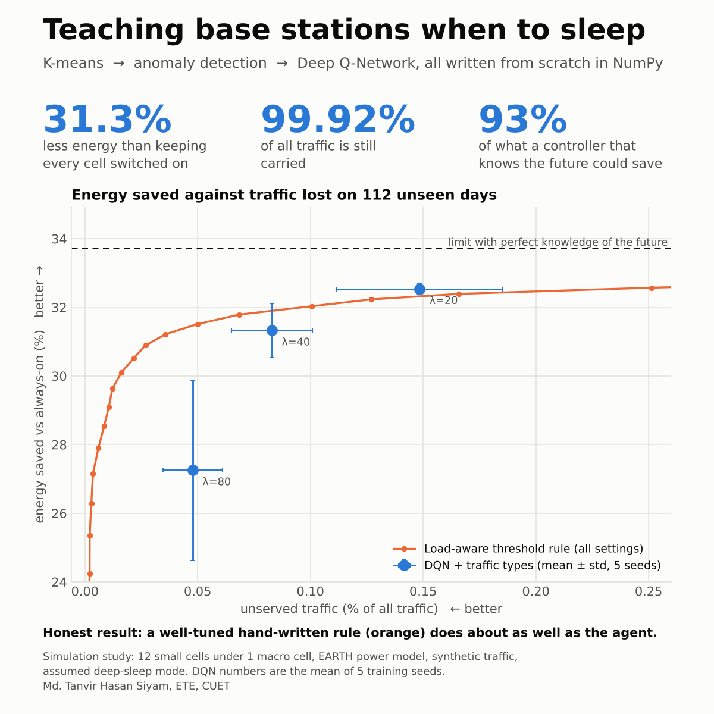
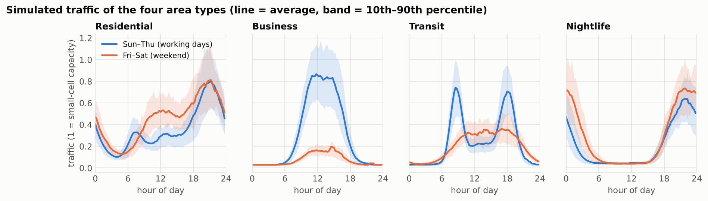
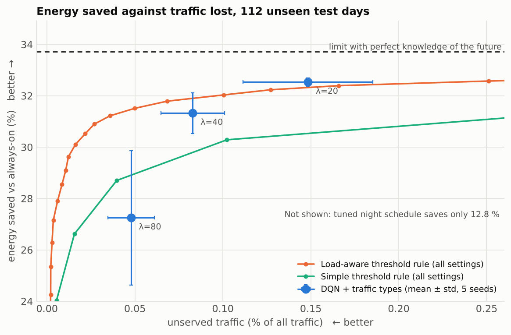
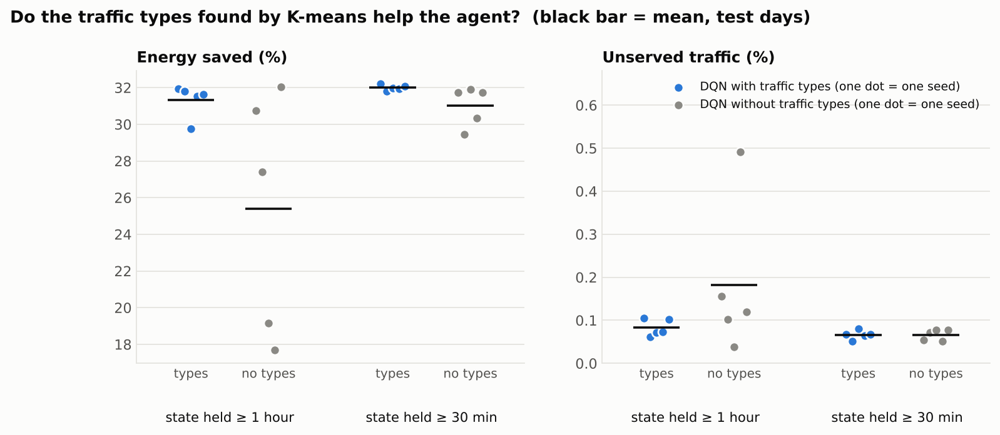
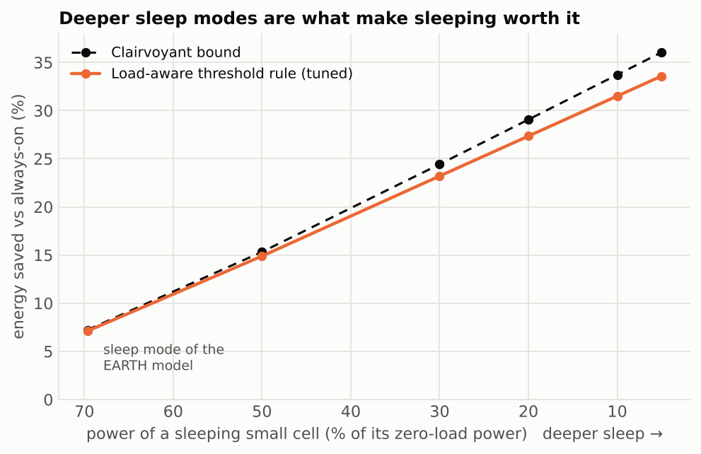

# GreenRAN: when should a small cell go to sleep?

A simulation study of base-station sleep control that uses three things from
the Machine Learning Specialization (clustering, anomaly detection and deep
reinforcement learning) on one telecom problem. Everything is written in
NumPy, with no machine-learning library.



**Short version.** A Deep Q-Network that learns only from trial and error cuts
network energy by **31.3 %** compared with keeping every cell on, while
**99.92 %** of traffic is still carried. That is 93 % of what a controller with
perfect knowledge of the future could save. A carefully tuned hand-written rule
does about the same (31.8 %), which is probably the most useful result here.
The agent only became stable once it was given the traffic types that K-means
found: without them it saved 25.4 % on average and changed a lot from seed to
seed.

All traffic is simulated. No operator data is used.

## The problem

A mobile network is built for the busiest hour, but most hours are not busy.
Small cells that add capacity in the evening sit almost idle at 4 am and still
draw power. Putting them to sleep saves energy, but their users then fall back
on the macro cell. If the macro cell fills up, traffic is lost. So the
controller has to decide, again and again, which cells can sleep right now
without hurting service, and it has to decide before it knows what the next
hour looks like.

## Setup

| Item | Choice |
|---|---|
| Network | 1 macro cell (always on) and 12 small cells under it |
| Time step | 15 minutes; a cell must keep its on/off state for at least 1 hour |
| Traffic | 4 area types (residential, business, transit, nightlife), 3 cells each, Friday–Saturday weekend, noisy, with random flash crowds and silent drops |
| Power model | EARTH linear model [1]: `P = N_trx (P0 + Δp · Pmax · load)` |
| Macro cell | N_trx 6, Pmax 20 W, P0 130 W, Δp 4.7 (780 W idle, 1344 W full) |
| Small cell | micro cell: N_trx 2, Pmax 6.3 W, P0 56 W, Δp 2.6 (112 W idle) |
| Sleep power | main setting: 10 % of P0 (**an assumption** for a deep sleep mode). The EARTH value, 39 W per chain = 70 % of P0, is also tested |
| Capacity | small cell = 1 unit, macro cell = 4 units |

What the controller sees for each cell: the last three traffic measurements,
time of day, weekend flag, whether the cell is on, whether it is still inside
its 1-hour hold, the macro load, and how full the macro would be if this cell
and all quieter cells slept. It never sees the future.



## Method

**1. K-means: what kind of area is each cell in?**
Each working day of each cell becomes a 24-point curve scaled to mean 1, so only
the shape matters. K-means with 20 random starts groups the curves, the
silhouette score picks K, and each cell gets the cluster most of its days fall
in. This label goes into the agent as a one-hot input.

**2. Gaussian anomaly detection: is this traffic normal?**
For every cell the detector learns the usual traffic at each time of day. Two features
(how far the traffic is from usual, and how fast it changed) are each modelled
with a Gaussian. A sample is flagged when `p(x) < ε`, and ε is picked by F1 on
labelled validation days. A "safety guard" uses the detector online: if a cell
shows a spike, it is forced on for the next hour.

**3. Deep Q-Network: who sleeps?**
One network (2 hidden layers of 64 units) is shared by all cells. For each
cell it outputs the value of "sleep" and of "stay on". It is trained with
experience replay, a soft-updated target network and ε-greedy exploration.
Backpropagation and Adam are written by hand and checked against a numerical
gradient. The reward of a cell is the energy its choice cost compared with the
other choice, minus λ times the traffic that was lost because it slept, minus
a small switching cost.

**Baselines.** Always-on, a night timetable, a threshold on the cell's own
traffic, and a load-aware threshold that puts the quietest cells to sleep
first and stops when the macro would pass a set fill level. There is also a
clairvoyant bound that knows the next 15 minutes exactly and ignores the hold
time. No real controller that avoids overload can use less energy than it.

**Protocol.** Every rule and the agent's λ are tuned on 56 validation days:
lowest energy with unserved traffic of at most 0.05 % of all traffic. The 112
test days come from a different random seed and were scored once at the end.
The agent is trained with 5 seeds; numbers are mean ± standard deviation.

## Results

Main setting (deep sleep, state held ≥ 1 hour), 112 test days. Always-on uses
58.0 kWh per day.

| Controller | Energy saved | Unserved traffic | Switches per cell per day |
|---|---|---|---|
| Night timetable (tuned) | 12.8 % | 0.051 % | 2.0 |
| Threshold (tuned) | 28.7 % | 0.040 % | 3.3 |
| Load-aware threshold (tuned) | **31.8 %** | 0.068 % | 3.4 |
| DQN with traffic types (λ = 40) | **31.3 ± 0.8 %** | 0.083 ± 0.018 % | 3.6 |
| DQN with traffic types + safety guard | 31.3 ± 0.8 % | 0.074 ± 0.014 % | 3.6 |
| DQN without traffic types | 25.4 ± 5.9 % | 0.181 ± 0.160 % | 11.2 |
| Clairvoyant bound | 33.7 % | 0.002 % | 4.3 |



### Findings

1. **The agent learns a good policy from reward alone, but it does not beat a
   well-tuned rule.** It reaches 93 % of the clairvoyant saving. At the
   selected λ = 40 the load-aware rule is slightly better on both energy and
   unserved traffic. Along the whole trade-off curve the two are close: at
   λ = 20 the agent is a little above the rule's curve (32.5 % against 32.3 %
   at the same unserved traffic), at λ = 40 and 80 it is below, and λ = 80
   trains badly.

2. **The clusters from K-means are what make the agent work when decisions
   last an hour.** With the traffic type as input, all 5 seeds land between
   29.8 % and 31.9 %. Without it, two seeds fall below 20 % and the cells flip
   on and off about three times as often. When the hold time is only 30
   minutes the type matters much less (32.0 ± 0.1 % with, 31.0 ± 1.0 %
   without). A likely reason: a cell that must commit for an hour has to know
   what kind of day it is about to have, and three past samples do not tell it.

   

3. **With the original EARTH sleep mode, learning is not needed at all.** That
   sleep mode still draws 70 % of idle power, so sleeping saves little. A plain
   threshold gets 7.1 % and the bound is 7.2 %. The DQN did worse here
   (5.1 ± 1.6 %, 3 seeds). The savings only become large when the sleep mode is
   deep, and that is also where the rule starts to fall behind the bound.

   

4. **The safety guard helps only a little.** It lowers unserved traffic from
   0.083 % to 0.074 % at almost no energy cost. The first 15 minutes of a
   flash crowd cannot be predicted, and after that the agent already reacts by
   itself, so the guard mostly helps cells that are locked in their hold time.

5. **The unsupervised parts on their own.** Silhouette picks K = 3, not 4:
   residential and nightlife cells both peak in the evening and are merged
   (purity 0.75; forcing K = 4 separates all four types). The anomaly detector
   gets F1 0.80 on test days (precision 0.81, recall 0.78). It catches 94 % of
   flash-crowd samples but only 58 % of drop samples, because a drop at night
   looks the same as a normal quiet night.

More figures: [clustering](figures/fig2_clustering.png),
[anomaly detection](figures/fig3_anomaly.png),
[learning curves](figures/fig4_training.png),
[one day of decisions](figures/fig6_one_day.png).
Every number above is in [`results/summary.md`](results/summary.md), which is
generated from [`results/results.json`](results/results.json).

## Limits

- The traffic is synthetic. The shapes are reasonable but hand-designed, not
  measured. The natural next step is a public dataset such as the Telecom
  Italia Milan data.
- The radio side is very simple: capacity is one number per cell. There is no
  path loss, interference or user position. A user moved to the macro cell is
  assumed to cost the same capacity as before, which is optimistic.
- The 10 % deep-sleep power is an assumption, not a measured value. Result 3
  shows how much the conclusions depend on it.
- Unserved traffic comes from a small number of rare events, so that column is
  noisy. Both the rule and the agent ended above the 0.05 % limit on test days
  even though they met it on validation days.
- The controller is assumed to know a sleeping cell's traffic demand (measured
  by the macro cell).
- The hold time, the loss, the learning-rate schedule and the input features
  were chosen while looking at validation days. Development started with a
  30-minute hold and moved to 1 hour; both are reported.
- Only vanilla DQN was tried. Double DQN, a centralised critic or a
  forecasting model in front of the rule may do better.

## Run it

```bash
pip install -r requirements.txt
python -m pytest -q                    # 9 checks, a few seconds
python scripts/demo.py                 # trains one small agent, under a minute
python scripts/run_experiments.py      # everything above, about 25 min on 2 cores
python scripts/make_figures.py         # figures/ and results/summary.md
```

Tested with Python 3.13, NumPy 2.5 and Matplotlib 3.11. Runs are seeded, so
the numbers should come out the same on the same versions.

## Files

```
greenran/
  config.py      power model and all constants
  traffic.py     traffic simulator
  env.py         the network: who carries what, power, unserved traffic, reward
  kmeans.py      K-means, silhouette, cell typing
  anomaly.py     Gaussian detector and the safety guard
  dqn.py         neural network, Adam, replay buffer, DQN training
  baselines.py   rules and the clairvoyant bound
  pipeline.py    tuning and scoring
scripts/         run_experiments.py, make_figures.py, demo.py
tests/           unit tests
results/         results.json, summary.md, trained weights
figures/
```

## References

1. G. Auer et al., "How much energy is needed to run a wireless network?",
   IEEE Wireless Communications, vol. 18, no. 5, pp. 40–49, 2011. (EARTH power
   model. The parameter table is also reproduced in arXiv:1901.10021.)
2. V. Mnih et al., "Human-level control through deep reinforcement learning",
   Nature, vol. 518, pp. 529–533, 2015. (DQN.)
3. Machine Learning Specialization, DeepLearning.AI and Stanford Online,
   Course 3: Unsupervised Learning, Recommenders, Reinforcement Learning.

## Author

Md. Tanvir Hasan Siyam, Electronics and Telecommunication Engineering, CUET.
MIT licence.
